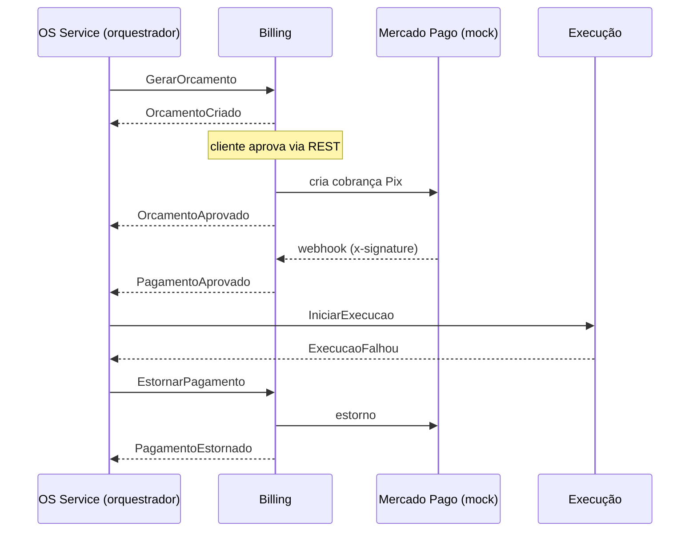

# Wrench Billing Service

Microsserviço de **orçamento, aprovação, pagamento (Pix) e estorno** da Wrench Auto Repair
(Tech Challenge, Fase 4, grupo BGT³). Faz parte da Saga orquestrada da Ordem de Serviço: o orquestrador
vive no OS Service e este serviço reage aos comandos dele e publica o resultado de cada etapa.

> **Pagamento mockado.** O Mercado Pago está atrás da porta `IPagamentoGateway` e a implementação atual é um
> **mock** (`MockPagamentoGateway`). O webhook, a validação de `x-signature` e a idempotência são reais e
> testados; só o provedor é simulado. Para usar o sandbox real, implemente `IPagamentoGateway` (com o id do
> orçamento como `X-Idempotency-Key`) e troque o registro em `wrench.billing.infra/DependencyInjection.cs`.

## Arquitetura

Mesma convenção de pastas e nomes dos demais serviços (`wrench.<serviço>.<camada>`):

```
wrench.billing.sln
src/
  wrench.billing.domain        Orcamento, Pagamento, WebhookEvento (regras e transições de estado)
  wrench.billing.application   Services/, Responses/, Options/, Exceptions/, Webhooks/, Extensions/,
                               Abstractions/ (portas), Consumers/, Contracts/ (mensagens)
  wrench.billing.infra         EF Core + Npgsql, outbox/inbox, MassTransit + SQS, gateway mock, worker
  wrench.billing.api           Controllers, Models, Options, Configuration, Middlewares, Program.cs
tests/
  wrench.billing.tests         xUnit (Api, Application, Domain, Infra, Support) + BDD Reqnroll (Bdd/) + coverage.runsettings
docs/postman/                  collection Postman do serviço
chart/                         chart Helm (wrench-billing)
terraform/                     database e role do Billing no RDS (ver terraform/README.md)
```

| Tema | Decisão |
|---|---|
| Banco | PostgreSQL `wrench_billing`, exclusivo do serviço. Nenhum outro serviço o acessa. |
| Mensageria | Amazon SNS + SQS via MassTransit 8.5.x (a linha 9.x é comercial), fila por consumer com prefixo `billing-`. |
| Consistência | **Outbox transacional**: estado e evento são gravados na mesma transação. **Inbox**: reentrega do SQS (at-least-once) não reprocessa. |
| Retry | Exponencial (5 tentativas). `DomainException` e `NaoEncontradoException` não sofrem retry e vão para a fila de erro/DLQ. |
| Idempotência | Transições de domínio retornam `false` se já aplicadas; `pagamentos.ExternalId` é único; webhooks guardam a chave em `webhook_eventos`. |
| Webhook | Valida `x-signature` (HMAC-SHA256) e **consulta o status no provedor** em vez de confiar no corpo. |
| Plano B do webhook | `PagamentoReconciliacaoWorker` consulta pagamentos pendentes e expira os Pix vencidos (30 min). |

### Consistência e idempotência

- Cada caso de uso grava o novo estado e publica o evento na mesma transação (outbox).
- Comandos reentregues não duplicam efeito: gerar orçamento devolve o existente, aprovar devolve a cobrança já criada,
  cancelar e estornar reafirmam o resultado.
- Pagamento aprovado no provedor para uma cobrança já expirada ou cancelada localmente não publica confirmação;
  só gera log de erro (exige estorno manual).

## Eventos

Toda mensagem carrega `OrdemServicoId` e `CorrelationId`. O `CorrelationId` é **texto livre**, como no
`execucao-service`, e viaja no header `correlationId`; quando é um GUID também vira o CorrelationId do transporte.

Os contratos vêm do pacote compartilhado **`Wrench.Contracts` 1.0.0**, publicado no GitHub Packages a partir do
repositório `euthribeiro/wrench-contracts`, que é a fonte da verdade. Mudanças de contrato entram lá primeiro, de
forma aditiva na linha 1.x. O restore precisa de autenticação: veja "Build local" mais abaixo.

**Consome (comandos do orquestrador)**

| Mensagem | Efeito |
|---|---|
| `GerarOrcamento` | Cria o orçamento e publica `OrcamentoCriado` (ou `OrcamentoFalhou` se os dados forem inválidos). |
| `CancelarOrcamento` | Compensação: cancela orçamento e cobrança pendente. Não publica evento — a Saga não aguarda resposta desta compensação. |
| `EstornarPagamento` | Compensação: estorna o pagamento confirmado; publica `PagamentoEstornado` ou `EstornoFalhou`. |

**Publica**

| Evento | Quando |
|---|---|
| `OrcamentoCriado` / `OrcamentoFalhou` | Resultado de `GerarOrcamento`. |
| `OrcamentoAprovado` | Cliente aprovou; cobrança Pix criada. O evento carrega `ValorAprovado` e `AprovadoEm`; o Pix copia-e-cola fica na resposta HTTP da aprovação, não no contrato da Saga. |
| `OrcamentoRecusado` | Cliente recusou. |
| `PagamentoAprovado` | Webhook ou conciliação confirmou o pagamento. |
| `PagamentoFalhou` | Pagamento recusado, cancelado no provedor ou expirado (o Billing já cancela cobrança e orçamento). |
| `PagamentoEstornado` / `EstornoFalhou` | Resultado de `EstornarPagamento`. |



| Falha | Reação do Billing |
|---|---|
| Orçamento inválido | `OrcamentoFalhou` |
| Cliente recusa | `OrcamentoRecusado`; o orquestrador envia `CancelarOrcamento` |
| Pagamento recusado ou expirado | Cancela cobrança e orçamento; `PagamentoFalhou` |
| Execução não aceita a OS | `EstornarPagamento` → `PagamentoEstornado` (ou `EstornoFalhou`) |

## API (`/api/v1`)

Documentação interativa em `/docs-ui`, especificação em `/openapi/v1.json` e collection Postman em
[`docs/postman/billing-service.postman_collection.json`](docs/postman/billing-service.postman_collection.json)
(inclui o webhook com assinatura calculada por script). Versionamento pela URL.

| Método | Rota | Perfis | Descrição |
|---|---|---|---|
| GET | `/orcamento/{id}` | Admin, Funcionario, Cliente | Consulta orçamento |
| GET | `/orcamento/ordem-servico/{ordemServicoId}` | Admin, Funcionario, Cliente | Orçamento mais recente da OS |
| PUT | `/orcamento/{id}/aprovar` | Cliente | Aprova e devolve a cobrança Pix |
| PUT | `/orcamento/{id}/recusar` | Cliente | Recusa (`{ "motivoRecusa": "..." }`, opcional) |
| GET | `/pagamento/orcamento/{orcamentoId}` | Admin, Funcionario, Cliente | Consulta o pagamento |
| POST | `/pagamento/webhook` | pública + `x-signature` | Notificação do provedor |
| POST | `/simulacao/pagamentos/{orcamentoId}/{aprovado\|recusado\|expirado}` | Admin, Funcionario | **Somente mock**: define o resultado e dispara o webhook assinado |
| GET | `/health` e `/health/ready` (fora de `/api/v1`) | pública | Liveness e readiness (inclui o banco) |

Erros: `401` token ou assinatura inválidos, `403` perfil sem permissão, `404` não encontrado, `409` transição de estado inválida.

> `aprovar` e `recusar` mantêm o caminho e o perfil do `OrcamentoController` do monólito. O OS Service extraído
> não deve mais expor `/orcamento/*`, e o API Gateway precisa rotear `/api/v1/orcamento` e `/api/v1/pagamento`
> (incluindo o webhook público) para este serviço. O `{id}` do orçamento é gerado aqui e chega ao OS Service no
> evento `OrcamentoCriado`.

## Topologia de mensagens

Os nomes abaixo são os **provisionados pelo Terraform** do `infra-k8s`, em `terraform/mensageria`. Quem cria
tópicos, filas, DLQs e assinaturas é o Terraform — o Billing apenas se conecta ao que já existe. Os valores
continuam em configuração, então dá para apontar para outro ambiente sem recompilar:

| Configuração | Padrão | Efeito |
|---|---|---|
| `Messaging:TopicoEventos` | `wrench-billing-events` | Todos os eventos publicados pelo Billing vão para este tópico |
| `Messaging:TopicoComandos` | `wrench-os-events` | Tópico do orquestrador, de onde vêm os comandos |
| `Messaging:FilaGerarOrcamento` | `wrench-billing-gerar-orcamento` | Fila que recebe apenas `GerarOrcamento` |
| `Messaging:FilaCancelarOrcamento` | `wrench-billing-cancelar-orcamento` | Fila que recebe apenas `CancelarOrcamento` |
| `Messaging:FilaEstornarPagamento` | `wrench-billing-estornar-pagamento` | Fila que recebe apenas `EstornarPagamento` |

**Por que uma fila por comando.** As assinaturas usam `raw_message_delivery`, ou seja, o corpo entregue é o JSON
puro do contrato, sem o envelope do MassTransit. Sem envelope não há como inferir o tipo da mensagem, então cada
fila recebe um único tipo — o filter policy da assinatura filtra pelo message attribute `tipo`. Assim o endpoint
sabe em qual contrato desserializar.

**Metadados.** Toda publicação passa por `PublishExtensions.PublishComCorrelacao`, que seta o header `tipo` (o
que o filter policy avalia; sem ele a mensagem é descartada antes de chegar na fila) e o `correlationId`.

**`ConfigureConsumeTopology` fica desligado** nos três endpoints, para que o MassTransit não crie tópicos e
assinaturas por fora do Terraform.

- No Kubernetes os valores vêm do chart (`messaging.*`).
- O código está em `src/wrench.billing.infra/Mensageria/MensageriaTopologia.cs` e `DependencyInjection.cs`, com testes em `Infra/InfrastructureTests.cs`.
- A IAM do IRSA (`wrench-billing-sa`) já permite publicar no tópico e consumir as três filas; as DLQs são provisionadas junto.

## Observabilidade

Mesmo padrão do `execucao-service` (OpenTelemetry + Serilog, destino New Relic via OTLP):

- **Logs** em JSON no console (`RenderedCompactJsonFormatter`) com `service.name`, `deployment.environment`, `trace_id`/`span_id`
  e `CorrelationId`; também enviados por OTLP quando `OTEL_EXPORTER_OTLP_ENDPOINT` está definido.
- **Traces e métricas** de ASP.NET Core, HttpClient e runtime, mais a fonte/medidor `MassTransit`, que cria os spans de
  publish/consume e propaga o contexto (`traceparent`) nas mensagens para ligar HTTP e Saga no mesmo trace.
- **`X-Correlation-ID`** por requisição HTTP: reaproveitado se enviado, gerado se não, devolvido no response e incluído nos logs.
  É independente do `correlationId` da Saga, que viaja nas mensagens.
- `/health*` fica fora dos traces.
- No Kubernetes as credenciais vêm do Secret `wrench-billing-newrelic` (chart: `newRelic.licenseKey`); sem a chave a telemetria
  fica desligada (`OTEL_SDK_DISABLED=true`) e o deploy não quebra.

> Ainda **não validado** em ambiente real: o envio ao New Relic e a continuidade do trace pelo SQS dependem da homologação.

## Modelo de dados (PostgreSQL)

Migration `Inicial` em `src/wrench.billing.infra/Persistence/Migrations`: `orcamentos`, `orcamento_itens`,
`pagamentos`, `webhook_eventos` e as tabelas de outbox/inbox do MassTransit.

```powershell
dotnet tool restore
dotnet tool run dotnet-ef migrations add <Nome> --project src/wrench.billing.infra --output-dir Persistence/Migrations
```

O database `wrench_billing` e o role de menor privilégio são criados por `terraform/`.

## Configuração

Variáveis de ambiente usam `__` (ex.: `Pagamento__WebhookSecret`).

| Chave | Descrição |
|---|---|
| `ConnectionStrings:Billing` | Postgres do Billing |
| `Database:MigrateOnStartup` | Aplica migrations ao subir |
| `Database:UseInMemory` | Banco em memória (testes) |
| `Messaging:Transport` | `Sqs` ou `InMemory` |
| `Messaging:Region` / `Messaging:ServiceUrl` | Região AWS / endpoint (LocalStack) |
| `Messaging:TopicoEventos` | Tópico SNS onde o Billing publica **todos** os seus eventos (padrão `wrench-billing-events`) |
| `Messaging:TopicoComandos` | Tópico SNS do qual consome os comandos do orquestrador (padrão `wrench-os-events`) |
| `Messaging:FilaGerarOrcamento` | Fila SQS de `GerarOrcamento` (padrão `wrench-billing-gerar-orcamento`) |
| `Messaging:FilaCancelarOrcamento` | Fila SQS de `CancelarOrcamento` (padrão `wrench-billing-cancelar-orcamento`) |
| `Messaging:FilaEstornarPagamento` | Fila SQS de `EstornarPagamento` (padrão `wrench-billing-estornar-pagamento`) |
| `GITHUB_PACKAGES_TOKEN` | Token com escopo `read:packages`, necessário no `dotnet restore` para baixar o `Wrench.Contracts` |
| `Pagamento:WebhookSecret` | Segredo da validação do `x-signature` |
| `Pagamento:ExpiracaoPixMinutos` | Validade do Pix (padrão 30) |
| `Pagamento:ReconciliacaoIntervaloSegundos` | Intervalo da conciliação (padrão 30) |
| `Pagamento:Mock:FalharEstorno` | Força `EstornoFalhou` (demonstração) |
| `Simulacao:Habilitada` | Expõe `/api/v1/simulacao` (nunca em produção) |
| `Simulacao:WebhookBaseUrl` | Endereço pelo qual a simulação chama o webhook do próprio serviço |
| `Observability:ServiceName` | Nome do serviço nos traces e logs (padrão `wrench-billing-api`) |
| `OTEL_EXPORTER_OTLP_ENDPOINT` / `_PROTOCOL` / `_HEADERS` | Destino OTLP (New Relic). Sem endpoint o serviço instrumenta, mas não exporta |
| `JwtOptions:Secret/Issuer/Audience` | Mesmos valores do OS Service e da lambda de autenticação (a aplicação não sobe sem eles) |

Credenciais AWS vêm do IRSA no EKS (sem chaves estáticas). Segredos nunca entram no repositório.

## Como rodar

### Build local: token do GitHub Packages

O `Wrench.Contracts` vem de um feed autenticado, e o feed exige token **mesmo com o repositório público**. Sem a
variável abaixo o `dotnet restore` falha com 401:

```powershell
gh auth refresh -s read:packages
$env:GITHUB_PACKAGES_TOKEN = (gh auth token)
```

O `nuget.config` na raiz lê esse valor; nenhum token é versionado. No CI a variável é preenchida com o token do
próprio workflow, que tem `packages: read`.

```powershell
# Postgres + API em http://localhost:8082/docs-ui (barramento em memória, simulação habilitada)
docker compose up --build

# Ou direto, com um Postgres local já em execução (perfil Development)
dotnet run --project src/wrench.billing.api
```

Sem SNS/SQS local, a Saga completa só pode ser exercitada em homologação. Localmente é possível percorrer
orçamento → aprovação → pagamento com a API de simulação (precisa de um token JWT com perfil Cliente e outro Admin).

## Testes e cobertura

```powershell
dotnet test --collect:"XPlat Code Coverage" --settings tests/wrench.billing.tests/coverage.runsettings
reportgenerator "-reports:tests/**/coverage.cobertura.xml" "-targetdir:coverage-report" "-reporttypes:TextSummary;Html"
```

Resultado atual: 150 testes e cerca de 99% de cobertura de linhas (a exigência é 80%). O `coverage.runsettings` exclui
apenas `Program.cs`, migrations e código gerado, e é obrigatório passá-lo com `--settings` (sem ele as migrations entram
na conta). Os testes cobrem domínio, serviços, consumers, assinatura do webhook, gateway mock, DI e topologia, worker,
propagação do `correlationId`, observabilidade e a API inteira via `WebApplicationFactory`, com banco e barramento em memória.

### BDD (Reqnroll)

O fluxo completo está especificado em português em
[`tests/wrench.billing.tests/Bdd/Features/OrcamentoPagamentoEstorno.feature`](tests/wrench.billing.tests/Bdd/Features/OrcamentoPagamentoEstorno.feature)
e roda junto com os demais testes (`dotnet test`). São 10 cenários sobre os serviços reais, com banco em memória, gateway
mock e um publisher que registra os eventos:

- fluxo completo até o pagamento confirmado;
- **estorno** quando a execução não aceita a OS, estorno recusado pelo provedor e pedido de estorno repetido (sem devolver duas vezes);
- recusa do cliente seguida do cancelamento da Saga, pagamento recusado e Pix expirado;
- notificação duplicada do provedor com efeito único;
- orçamento já pago que não pode ser cancelado (só estornado) e orçamento com dados inválidos.

Os passos ficam em `Bdd/Steps/FluxoSteps.cs` e o estado do cenário em `Bdd/Support/FluxoContexto.cs`. O BDD exercita a
Saga dentro do Billing; o fluxo entre os três serviços só pode ser validado em homologação.

## Deploy

Imagem: `Dockerfile` (multi-stage). Chart Helm em [`chart/`](chart): Deployment, Service, ServiceAccount (IRSA), Secret,
TargetGroupConfiguration e a rota `/api/v1/orcamento` + `/api/v1/pagamento` no Gateway compartilhado `bgt3-gw`.
Namespace e Gateway **não** pertencem a este chart.

```powershell
helm upgrade --install wrench-billing ./chart -n production `
  --set image.repository=<ECR>/wrench/billing-api --set image.tag=<tag> `
  --set database.user=<role> --set database.password=<senha> `
  --set pagamento.webhookSecret=<segredo> `
  --set jwt.secret=<segredo> `
  --set serviceAccount.roleArn=<role-irsa-sns-sqs> `
  --set newRelic.licenseKey=<chave-opcional>
```

O chart mantém **1 réplica** e o autoscaling desligado enquanto o gateway for o mock, porque o estado simulado fica em memória.

A pipeline `.github/workflows/ci.yml` faz restore, build, testes com cobertura mínima de 80% e `helm lint`.
Falta a parte de SonarCloud, imagem no ECR e deploy no EKS, que dependem do workflow reutilizável da plataforma.

## Pendências conhecidas

- Pipeline completa (SonarCloud, ECR, deploy Helm): depende do workflow reutilizável do `infra-k8s`.
- **Integração ponta a ponta ainda não exercitada contra a AWS real**: a mensageria só sobe depois que o
  `terraform/mensageria` do `infra-k8s` for aplicado. Até lá, o caminho de teste é `Messaging:Transport=InMemory`.
- E-mail do orçamento: quem notifica o cliente é o OS Service, que tem SES e os event handlers. O contrato
  `GerarOrcamento` não carrega o e-mail, então `Orcamento.ClienteEmail` fica vazio e o `LogOrcamentoNotificador`
  apenas registra. Se o envio passar a ser do Billing, o campo volta ao contrato de forma aditiva na linha 1.x.
- `CancelarOrcamento` não publica evento de retorno: a Saga trata essa compensação como fire-and-forget.
- Collection Postman validada apenas como JSON e conferida com as rotas; ainda não foi importada e executada no Postman.
- Observabilidade e trace distribuído (Billing → SQS → OS Service) a validar no New Relic em homologação.
- Validado localmente (Docker 29, Helm 3.22): `docker build`, `docker compose up` com Postgres real (migrations aplicadas, `/health/ready` 200,
  aprovar → simulação → webhook assinado → orçamento `Pago`, 403 por perfil e 401 sem assinatura) e `helm lint`/`helm template`.
  Ainda **não** foi exercitado com SNS/SQS reais nem no EKS.
